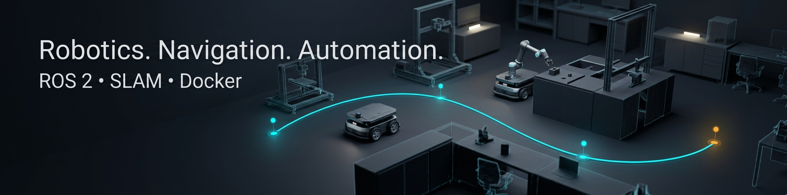

  

  

  
  
  

## 👨‍💻 About Me

Robotics and automation engineer with experience developing **ROS 2** applications in **Python** for mobile robots and robotic manipulators. Integrated **computer vision, navigation, and joint-trajectory control** in a two-robot delivery system, from **Gazebo** simulation to hardware deployment. Further experience includes **Docker** containerisation, warehouse simulation using **Java** and **AnyLogic**, and demand forecasting with **XGBoost**.

## 🛠️ Tech Stack

**Languages**

  
  
  
  
  

**Robotics & Computer Vision**

  
  
  
  
  
  
  
  

**Embedded & Systems**

  
  
  
  
  
  
  
  

**Platforms & Tools**

  
  
  
  
  
  

**CAD & Engineering Analysis**

  
  
  

## 🚧 Currently Building

### 🔹 [Robust AMR Navigation under Dynamic Obstacles & Sensor Failures](https://github.com/gouranshb2002/amr_dynamic_nav2)
> **Status:** In Progress (Phase 0) &nbsp;|&nbsp; **Focus:** ROS 2 Jazzy • Nav2 • C++ Costmap Plugin

Building a simulated differential-drive warehouse AMR in **Gazebo Harmonic** with a custom **C++ Nav2 Costmap2D prediction layer** that tracks moving obstacles from 2D LiDAR scans and projects their near-term motion-benchmarked against standard reactive navigation under controlled sensor-delay faults.

- **Key Components:** LiDAR scan clustering & constant-velocity tracking, custom `Costmap2D` swept-risk plugin, timestamp-preserving LiDAR delay relay, and a paired Python benchmark suite.
- **Tech Stack:** `ROS 2 Jazzy` `Gazebo Harmonic` `Nav2` `C++` `Eigen` `Python` `Ubuntu 24.04`
---

## 🚀 Featured Projects

| Project | Description | Technology Stack |
| :--- | :--- | :--- |
| **[Collaborative AI Delivery System](https://github.com/gouranshb2002/Collaborative_AI_Delivery_System)** | Two-robot delivery system (2× TurtleBot3 Waffle + OpenManipulator-X) with QR-code detection, 10 Hz navigation, and arm/gripper trajectory control across 4 pickup zones; deployed from Gazebo to hardware. | `ROS 2` `Python` `OpenCV` `Gazebo` `Docker` `TurtleBot3` `OpenManipulator-X` |
| **[Dynamic Task Allocation for Smart Warehouse](https://github.com/gouranshb2002/Dynamic_Task_Allocation_for_Smart_Warehouse.git)** | Built an AnyLogic simulation coordinating 10 AGVs and 4 forklifts via priority-weighted dispatch and state-machine agents, increasing simulated throughput by 11% and cutting fulfilment time by 10s/order. | `AnyLogic` `Java` `Discrete-Event Simulation` `State Machines` |
| **[Motion Model Analysis for Pose Estimation](https://github.com/gouranshb2002/Motion_Model_Analysis_for_Pose_Estimation.git)** | Python ROS 2 node comparing open-loop velocity integration vs. wheel-odometry feedback for TurtleBot3 in Dockerised Gazebo, quantifying 5% trajectory deviation (0.5 m over 10 m) from wheel slip and actuator dynamics. | `ROS 2` `Python` `Gazebo` `Docker` `TurtleBot3` |
| **[Autonomous Truck Architecture & Platooning](https://github.com/gouranshb2002/Autonomous_Truck_Architecture_and_Platooning.git)** | Concept architecture for hub-to-hub autonomous trucking (200 m LiDAR, radar, cameras, redundant drive-by-wire) with a hybrid MPC–DRL V2V platooning strategy (10–15% projected fuel savings at 15 m spacing). | `Sensor Fusion` `MPC` `DRL` `V2V` |
| **[Multi-Vegetable Automatic Transplanter](https://github.com/gouranshb2002/Multi-Vegetable_Automatic_Transplanter.git)** | Led design and testing of a tractor-mounted 2-row working prototype (~€784) using a Geneva mechanism at 60 seedlings/min; named co-inventor on granted Indian Patent 559564. | `Mechanical Design` `Geneva Mechanism` `Prototyping` |

## 📫 Contact

Open to **engineering roles** and **Master's thesis** opportunities in robotics, autonomous systems, and automation.

- **Email:** [gouransh.bhatnagar@stud.th-deg.de](mailto:gouransh.bhatnagar@stud.th-deg.de)
- **LinkedIn:** [linkedin.com/in/gouranshbhatnagar](https://www.linkedin.com/in/gouranshbhatnagar/)
- **Portfolio:** [View Project Portfolio (PDF)](./portfolio.pdf)
